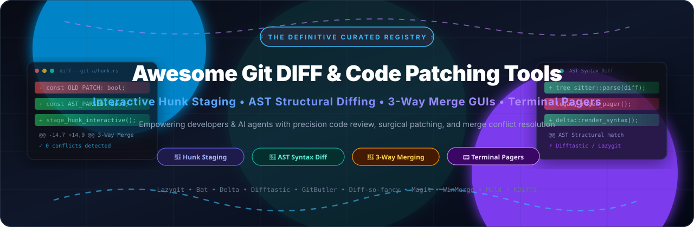

# Awesome-Git-DIFF-Code-Patching-Tools 🚀

  

  
  
  
  
  

---

# 🔍 Top Git Diff & Code Patching Tools

> ⚡ **A curated directory of premier commercial platforms & open-source solutions for visual git diffing, hunk staging, AST syntax diffing, terminal diff pagers, and 3-way merge conflict resolution.**

**Last updated:** November 2026

Welcome to the definitive index of **Git Diff & Code Patching Tools**. Whether you are an engineer auditing AI-generated pull request patches, a team lead resolving high-stakes 3-way merge conflicts across monorepos, or a terminal purist looking for syntax-highlighted structural AST diffs, this guide tracks the best commercial utilities and community open-source repositories available.

---

## 📑 Table of Contents
- [📊 Sector Overview & Market Dynamics](#-sector-overview--market-dynamics)
- [☁️ SaaS/Hosted & Commercial Platforms](#️-saashosted--commercial-platforms)
- [💻 Open-Source GitHub Projects](#-open-source-github-projects)
- [📈 Star History](#-star-history)
- [🛠️ How to Contribute](#️-how-to-contribute)
- [💖 Support & Thank You](#-support--thank-you)
- [⚠️ Disclaimer](#️-disclaimer)

---

## 📊 Sector Overview & Market Dynamics

The global Developer Productivity, Code Review & Version Control Tooling market is valued at approximately **$14.5B–$18.2B+ in 2026**, expanding at a ~18%–23% CAGR propelled by AI coding-agent patch auditing, monorepo code review velocity, and AST-aware static analysis. The sector exhibits a **moderately fragmented market structure**: foundational repository hosting and baseline Git GUIs remain highly concentrated around hyperscale winners (Microsoft/GitHub and Atlassian), whereas specialized visual diffing, structural AST diff engines, hunk-level staging clients, and 3-way merge utilities sustain an active, fragmented ecosystem split between entrenched bootstrapped commercial utilities (Beyond Compare, Sublime Merge, Tower, Fork) and dominant community open-source tools (`delta`, `Difftastic`, `Lazygit`, `Meld`).

---

## ☁️ SaaS/Hosted & Commercial Platforms

*Sorted descending by company scale, valuation, and annual revenue.*

| Platform | Description | Company Scale (Valuation / Revenue) | Starting Paid Tier | Free Tier / Trial Limit |
| :--- | :--- | :--- | :--- | :--- |
| **[GitHub Desktop (Microsoft)](https://github.com)** | Official open-core Electron desktop Git client by GitHub featuring visual syntax-highlighted diffs, partial line/hunk staging, and PR checkouts. | **Part of Microsoft / GitHub** (~$2B+ GitHub ARR; ~$3T+ Microsoft market cap) | **$0 / Free Client** (GitHub Team cloud features start at **$4 / user / month**) | **100% Free Forever** (MIT-licensed desktop client with unlimited local/public/private repo diffs and hunk staging) |
| **[Sourcetree (Atlassian)](https://sourcetreeapp.com)** | Free visual desktop Git and Mercurial GUI client for Windows and macOS featuring hunk/line staging, interactive rebase, and external diff tool hooks. | **Part of Atlassian Corp.** (~$4.5B+ annual revenue; ~$55B+ public market cap) | **$0 / Free Proprietary Software** (Requires free Atlassian account registration during setup) | **100% Free Forever** (Unlimited private and commercial repositories on Windows and macOS with zero seat fees) |
| **[GitKraken Client](https://gitkraken.com)** | Cross-platform desktop Git GUI and CLI featuring an interactive 3-way merge conflict editor, word-level diffs, and GitHub/Jira pull-request reviews. | **~$50M–$100M Est. Valuation** (~$20M+ est. ARR; >30M developers; acquired GitLens) | **$4.95 / user / month** billed annually (Pro tier for private repos & cloud Workspaces) | **Forever Free Plan** (100% free for **local and public cloud repositories**; paid plan required for private cloud repositories) |
| **[Sublime Merge (Sublime HQ)](https://sublimemerge.com)** | High-performance native C++ Git client from the makers of Sublime Text featuring blazing-fast line/hunk staging, 3-way merge tool, and regex search. | **Bootstrapped Australian Software Studio** (Profitable creators of Sublime Text) | **$99 one-time** personal license (includes 3 years of updates) or **$75 / seat / year** for business | **Unlimited Evaluation Trial** (Free download with no hard time cutoff and occasional purchase prompts; perpetual license removes prompt) |
| **[Beyond Compare (Scooter Software)](https://scootersoftware.com)** | Gold-standard commercial folder, file, source-code, CSV/data, and 3-way merge comparison utility across Windows, macOS, and Linux. | **Bootstrapped US Software Vendor** (Profitable 25+ year developer-tools company) | **$35 one-time** Standard license or **$70 one-time** Pro license (adds 3-way merge & folder sync) | **30-Day Full-Access Free Trial** (30 actual days of active use—not calendar days—with full Pro 3-way merge features) |
| **[Tower (fournova)](https://git-tower.com)** | Native macOS and Windows desktop Git client prized for single-line/hunk staging, drag-and-drop interactive rebase, stacked PRs, and instant undo. | **~$10M–$25M Est. Scale** (Profitable independent German Git software vendor) | **$69 / user / year** (Basic plan) or **$99 / user / year** (Pro plan with stacked PRs & worktrees) | **30-Day Full-Access Free Trial** (Includes full Pro features for 30 days; free licenses for students, teachers, and open-source maintainers) |
| **[Fork (Dan Pristupov)](https://git-fork.com)** | Fast, native macOS and Windows Git GUI client offering interactive line/hunk patching, visual 3-way merge conflict solver, and reflog explorer. | **Bootstrapped Indie Software** (Profitable independent two-person developer team) | **$59.99 one-time** perpetual license (valid across macOS and Windows with 3 years of updates) | **Unlimited Evaluation Trial** (Free download with no time cutoff and periodic purchase reminders; one-time license removes prompt) |
| **[SmartGit (syntevo)](https://syntevo.com)** | Cross-platform desktop Git client (Windows, macOS, Linux) with built-in file compare, 3-way conflict solver, index editor, and Git-Flow workflows. | **Bootstrapped German Software Vendor** (Profitable 20+ year developer-tools company) | **$6.90 / month** billed annually ($82.80/yr) or **$189 one-time** perpetual commercial license | **Forever Free Non-Commercial License** (100% free for open-source developers, students, teachers, and hobbyists + 30-day commercial trial) |
| **[Kaleidoscope (Letter Opener)](https://kaleidoscope.app)** | Native macOS diff and 3-way merge application comparing text, source code, images, PDFs, and folders with deep Xcode and Git integration. | **Bootstrapped Independent Mac Studio** (Letter Opener GmbH; German Mac software vendor) | **$8.00 / month** billed annually ($96/yr) or **$199 one-time** perpetual macOS license | **14-Day Full-Access Free Trial** (Full text, image, folder, and 3-way merge functionality on macOS for 14 days) |
| **[DiffMerge (SourceGear)](https://sourcegear.com)** | Cross-platform GUI application for visually comparing and merging files and folders across Windows, macOS, and Linux with intra-line highlighting. | **Bootstrapped US Software Vendor** (SourceGear LLC; developer tools provider) | **$0 / Free Proprietary Software** (Freeware binary distribution with zero seat fees) | **100% Free Forever** (Unlimited personal and commercial 2-way diffing, folder comparison, and 3-way file merging) |

---

## 💻 Open-Source GitHub Projects

*Sorted descending by GitHub stargazer count. Badges link directly to each repository's stargazers.*

| Project & Stargazers | License | Primary Focus | Description |
| :--- | :--- | :--- | :--- |
| **[Lazygit](https://github.com/jesseduffield/lazygit)**  | `MIT` | Interactive TUI Hunk Staging | Simple, blazing-fast terminal UI for git commands with granular line-by-line and hunk staging, interactive rebasing, and branch navigation. |
| **[bat](https://github.com/sharkdp/bat)**  | `Apache-2.0` | Terminal Syntax Diff Pager | Cat clone with syntax highlighting and Git modification gutter markers showing lines added, modified, and removed. |
| **[Delta](https://github.com/dandavison/delta)**  | `MIT` | Syntax-Highlighting Diff Pager | High-performance syntax-highlighting pager for git, diff, and grep output featuring side-by-side view, word-level diffing, and custom themes. |
| **[Difftastic](https://github.com/Wilfred/difftastic)**  | `MIT` | Structural AST Syntax Diff Engine | CLI structural diff tool that parses code using tree-sitter grammars and compares syntax trees rather than raw text lines. |
| **[GitUI](https://github.com/extrawurst/gitui)**  | `MIT` | Rust Terminal Git GUI | Ultra-fast C/Rust-backed terminal UI for git with fast hunk-level staging, keybindings, and low memory overhead. |
| **[GitButler](https://github.com/gitbutlerapp/gitbutler)**  | `FSL-1.1-Apache-2.0` | Virtual Branches & Hunk Manager | Modern Git client built in Rust and Svelte allowing simultaneous work across virtual branches and surgical drag-and-drop hunk management. |
| **[Diff-so-fancy](https://github.com/so-fancy/diff-so-fancy)**  | `MIT` | Human-Readable Diff Pager | Upgrades terminal diffs into human-readable views by removing leading `+`/`-` clutter and highlighting changed words. |
| **[Tig](https://github.com/jonas/tig)**  | `GPL-2.0` | Ncurses Git Explorer & Diff View | Text-mode interface for Git acting as a repository browser, interactive stage editor, and pager for Git commit diffs. |
| **[Hunk](https://github.com/modem-dev/hunk)**  | `MIT` | Laser-Focused Hunk Stager | Fast and targeted interactive hunk-level staging tool designed for crafting clean, atomic commits without full GUI overhead. |
| **[WinMerge](https://github.com/winmerge/winmerge)**  | `GPL-2.0` | Visual 2-Way & 3-Way Differencing | Established open-source visual differencing and merging tool for Windows supporting files, folders, binary diffs, and 3-way merge editing. |
| **[Magit](https://github.com/magit/magit)**  | `GPL-3.0` | Emacs Git Porcelain & Hunk Editor | Comprehensive Git interface inside Emacs renowned for unparalleled precision in staging hunks, individual lines, and interactive rebases. |
| **[Diffview.nvim](https://github.com/sindrets/diffview.nvim)**  | `GPL-3.0` | Neovim Single-Tab Diff Explorer | Clean Neovim single-tabpage interface for cycling through diffs of modified files, merge conflicts, and commit history. |
| **[icdiff](https://github.com/jeffkaufman/icdiff)**  | `PSF-2.0` | Side-by-Side Colored CLI Diff | Terminal utility showing side-by-side colorized diffs for quick visual inspection of code and file modifications. |
| **[diff-pdf](https://github.com/vslavik/diff-pdf)**  | `GPL-2.0` | Visual PDF Document Differ | Visual tool for comparing two PDF files and highlighting differences geometrically and textually across pages. |
| **[git-branchless](https://github.com/arxanas/git-branchless)**  | `Apache-2.0` | Stacked Diff & Restack Tooling | Suite of tools providing stacked diff workflows, in-memory patch rebasing, and intelligent undo navigation for Git. |
| **[Meld](https://gitlab.gnome.org/GNOME/meld)** (Mirror: **[GNOME/meld](https://github.com/GNOME/meld)**)  | `GPL-2.0` | GNOME Visual 2/3-Way Diff GUI | Visual diff and 3-way merge tool targeted at developers for comparing files, directories, and version-controlled repositories. |
| **[ydiff](https://github.com/ymattw/ydiff)**  | `BSD-3-Clause` | Side-by-Side Incremental Diff Pager | View colored, incremental, side-by-side and unified diffs in terminal or browser from Git, Mercurial, and SVN. |
| **[KDiff3](https://invent.kde.org/sdk/kdiff3)** (Mirror: **[KDE/kdiff3](https://github.com/KDE/kdiff3)**)  | `GPL-2.0` | KDE 3-Way File & Directory Merge | Robust file and directory comparison and 3-way merge editor with automatic conflict resolution capabilities. |

---

## 📈 Star History

---

## 🛠️ How to Contribute

Contributions are welcome! Please feel free to submit a pull request or suggest new tools:

1. 🍴 Fork the repository.
2. 🌿 Create a new feature branch (`git checkout -b feature/new-diff-tool`).
3. 📝 Add your tool with factual descriptions, license details, and pricing/stargazer links.
4. 🚀 Commit your changes (`git commit -m 'feat: add new diff tool'`).
5. 📬 Push to the branch (`git push origin feature/new-diff-tool`) and open a Pull Request.

---

## 💖 Support & Thank You

Thank you so much for exploring and supporting **Awesome-Git-DIFF-Code-Patching-Tools**! If you find this directory valuable for your workflow, code reviews, or patch auditing:

- ⭐ **Star this repository** on GitHub to help other engineers discover it.
- 🍴 **Fork and share** it with your developer community and team members.
- ☕ **Buy me a coffee**: If you would like to support maintenance and future updates, please consider visiting the **[GitHub Sponsors Dashboard](https://github.com/sponsors/ishandutta2007)**.

Every bit of encouragement and contribution helps keep this ecosystem index fresh and comprehensive! 🙌

---

## ⚠️ Disclaimer

Product names, logos, brands, and registered trademarks quoted or referred to in this repository are the property of their respective owners. Inclusion in this curated index does not imply official endorsement or sponsorship.
